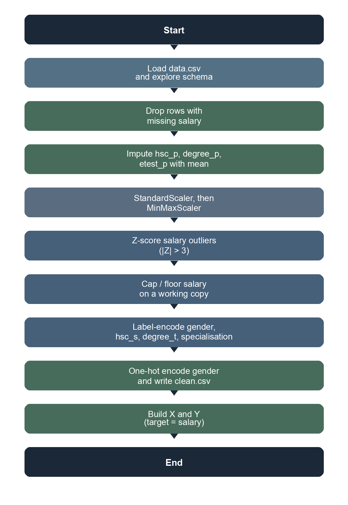

# Exp 2a – Data Wrangling and Transformation (Placement)

**Name:** Francis Reuben R  
**USN:** 1RUA25CSE0168  
**Section:** G  
**Experiment:** 2a  
**Title:** Data Wrangling and Transformation (Student Placement Dataset)

## Objective

Wrangle the student placement table: handle missing values, scale numerical features, review salary outliers, encode categoricals, and export a model-ready CSV with features `X` and target `Y` (`salary`).

## Pipeline



## Notebook

| File | What it does |
|---|---|
| `Ex-2a-Placement_Data_Wrangling.ipynb` | Placement wrangling: missing values, scaling, outliers, encoding |

## Data files

| File | Role |
|---|---|
| `data.csv` | Source table (215 students) |
| `clean.csv` | Encoded table after salary-missing drop, mean imputation, MinMax scaling, and gender one-hot encoding (148 rows) |

## Run

```bash
pip install -r ../../../../requirements.txt
jupyter notebook Ex-2a-Placement_Data_Wrangling.ipynb
```
