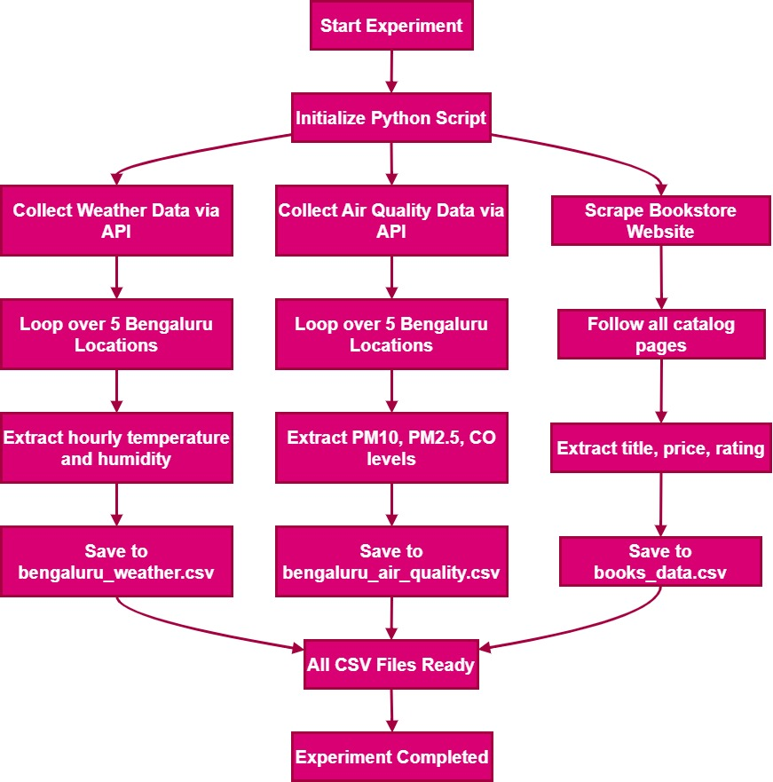

# Lab 01 – Data Collection

**Name:** Francis Reuben R  
**USN:** 1RUA25CSE0168  
**Section:** G  
**Experiment:** 1  
**Title:** Data Collection

## Objective

Build a Python data-collection pipeline that:

1. Pulls hourly **weather** (temperature, relative humidity) for five Bengaluru locations over the past 21 days from the Open-Meteo Forecast API.
2. Pulls hourly **air quality** (PM10, PM2.5, CO) for the same locations over 30 days from the Open-Meteo Air Quality API.
3. Scrapes **book title, price, and rating** from the practice catalogue at [books.toscrape.com](https://books.toscrape.com/).

Outputs are stored as CSV files for later labs.

## Pipeline



## Notebooks

| File | What it does |
|---|---|
| `Ex-1-Bengaluru_Real_Time_Data_Collection.ipynb` | Weather and air-quality collection for 5 Bengaluru locations |
| `Ex-1-Web_Scraping.ipynb` | Bookstore scrape (all catalogue pages) plus a short quotes.toscrape practice |
| `Ex-1-Practice-Problem.ipynb` | Practice task: RemoteOK job listings via the public API |

## Output files

| File | Source |
|---|---|
| `bengaluru_weather.csv` | Open-Meteo weather API |
| `bengaluru_air_quality.csv` | Open-Meteo air quality API |
| `books_data.csv` | books.toscrape.com |
| `quotes.csv` | quotes.toscrape.com |
| `remoteok_jobs.csv` | remoteok.com/api |

## Run

```bash
pip install -r ../../../requirements.txt
jupyter notebook
```

Run the three notebooks in order. Each notebook writes its CSV next to itself.

## Notes

Live property sites (99acres, MagicBricks, NoBroker) disallow automated collection in their terms. This lab uses Open-Meteo (open API, no key) and practice scrape sites only.
