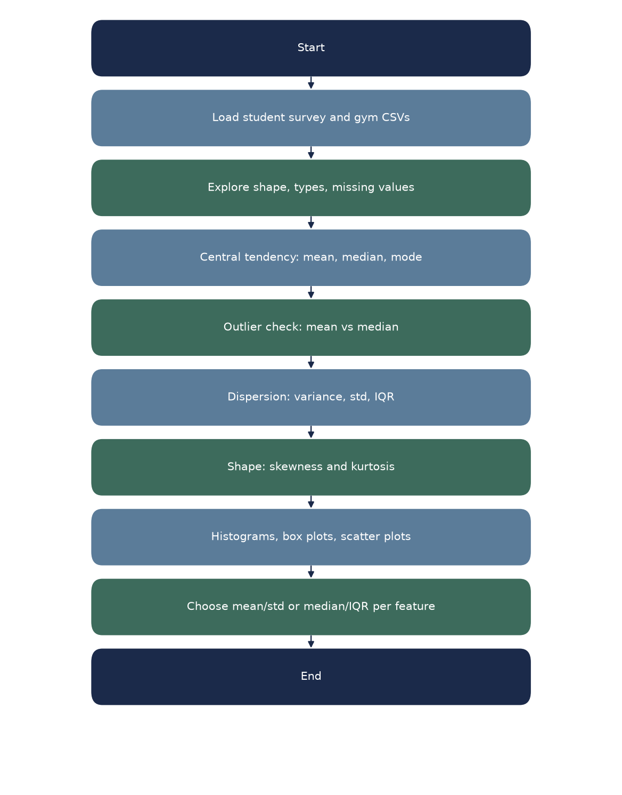

# Lab 03 – Descriptive Statistics and Visualization

**Name:** Francis Reuben R  
**USN:** 1RUA25CSE0168  
**Section:** G  
**Experiment:** 3  
**Title:** Descriptive Statistics and Visualization

## Objective

Compute and interpret measures of central tendency, dispersion, and distribution shape, then support those numbers with histograms, box plots, and scatter plots. The follow-up notebook repeats the same choices on a gym membership table whose shapes are not labelled in advance.

## Pipeline



## Notebooks

| File | What it does |
|---|---|
| `Lab-3.ipynb` | Student survey (160 rows): mean/median/mode, variance and IQR, skewness and kurtosis, plots, Pearson correlation |
| `Lab3_Gym_Membership.ipynb` | Gym members (150 rows): Q1–Q13 plus bonus group-by on preferred workout |

## Data files

| File | Role |
|---|---|
| `student_survey_synthetic.csv` | Taught lab table (`exam_score`, `monthly_allowance_inr`, `quiz_score`, `weekly_study_hours`) |
| `gym_members_synthetic.csv` | Assignment table (`workout_duration_minutes`, `monthly_membership_fee_inr`, `attendance_percentage`, `weekly_visit_count`) |

These are the current Lab 3 files (student survey and gym assignment). This folder does not use the older Fortune 500 / income-expense tables.

## Run

```bash
pip install -r ../../../requirements.txt
jupyter notebook Lab-3.ipynb
jupyter notebook Lab3_Gym_Membership.ipynb
```

Run `Lab-3.ipynb` first, then the gym assignment. Both notebooks should be restarted and run all the way through before submission.
